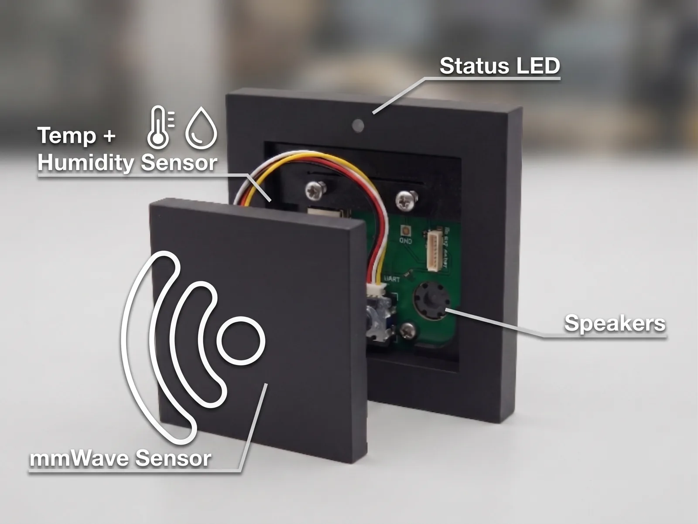

# SmartSwitch D2 — Zigbee wall switch

A smart wall switch that does more than switch: ESP32-C6 Zigbee router with mmWave presence
detection, climate sensors, a status LED and two speakers — built to fit a standard European
wall box.

> ⚠️ **Mains voltage** — This device is connected to 230 V AC. Working with mains voltage can
> cause serious injury, death or fire. Only build or install it if you are qualified to do so,
> and follow your local electrical regulations. Provided as is, without any warranty — use at
> your own risk.

## Features

- **ESP32-C6-MINI-1** — Zigbee 3.0 router, works with Zigbee2MQTT
- **24 GHz mmWave presence sensor** (HLK-LD2410) — detects people, even when sitting still
- **BME280** — temperature, humidity and air pressure
- **2 speakers** (MAX98357A amplifier) — sounds and voice notifications
- **Addressable status LED** and a mechanical key switch
- **Two stacked 2-layer PCBs** — power board (230 V AC → 5 V DC) and main board
- **Firmware updates over the air** (A/B slots with automatic rollback)

## Repository

| Folder | Contents |
|---|---|
| [`hardware/`](hardware) | Altium projects, schematic PDFs, Gerbers, BOMs and assembly drawings for the main board and power board (rev 1.2) |
| [`mechanical/`](mechanical) | 3D-printable front plate and hinges (STL) |
| [`software/`](software/smartswitchd2) | Firmware (Arduino sketch, ESP32-C6) — build and flash instructions in its README |
| [`zigbee2mqtt/`](zigbee2mqtt) | External converter for Zigbee2MQTT |
| [`docs/`](docs/photos) | Photos |

## Build your own

1. **PCBs** — upload the Gerber zip of each board to your PCB manufacturer (e.g. JLCPCB).
2. **Parts** — order from the BOMs (Mouser part numbers included) and assemble using the
   assembly drawings.
3. **Firmware** — flash over USB once; see [`software/smartswitchd2/README.md`](software/smartswitchd2/README.md) for the
   Arduino board settings.
4. **Zigbee2MQTT** — add `zigbee2mqtt/smartswitch.mjs` as an external converter, enable
   pairing and press the switch.
5. **Mount** — the front is designed around a GIRA switch rocker and cover frame (not
   included), with the 3D-printed parts from `mechanical/`.

## License

Hardware: CERN-OHL-S-2.0 · Firmware: GPL-3.0 · Docs and sounds: CC BY-SA 4.0 — see
[`LICENSE.md`](LICENSE.md).

## More

Project page: [jongtronics.com/projects/zigbee-smart-switch](https://jongtronics.com/projects/zigbee-smart-switch)

Designed by Paul de Jong — [Jongtronics](https://jongtronics.com)
